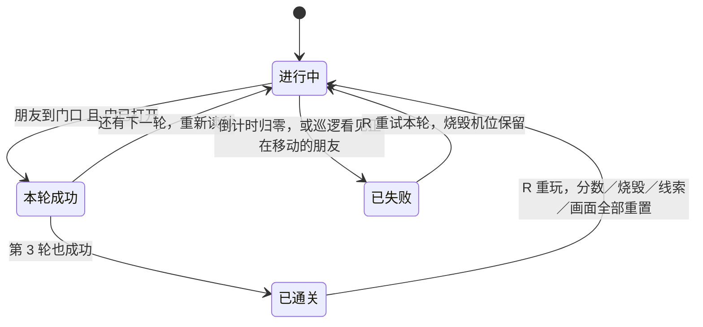
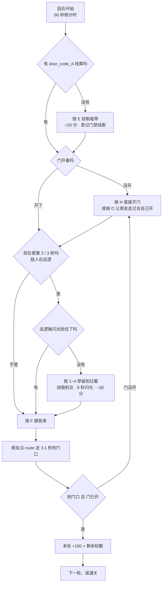
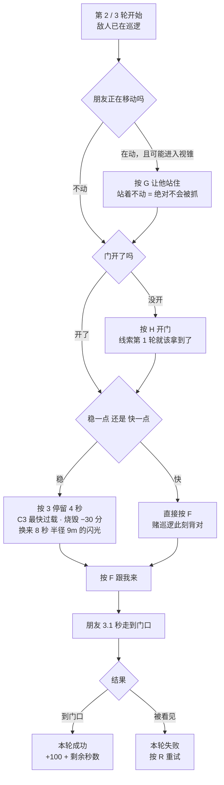

# Demo 状态图与通关速查

给「按键太多、看不出怎么赢」准备的对照表。**图和表都是手工文本，可以直接改**：
Mermaid 在 GitHub 网页和 VS Code Markdown 预览里都会直接渲染，改完提交前可以用
<https://mermaid.live> 粘一下看效果。

本篇只描述**现状**（`develop` @ `3eef9f8`）。权威来源仍然是代码：

> 想直接看/改这张图：打开 `scenes/state_graph_editor.tscn`（2D 状态图编辑器），
> 状态、切换、结局都在里面可拖拽编辑，保存回 `resources/data/state_graph.json`。
> 用法见 [STATE_GRAPH_EDITOR.md](STATE_GRAPH_EDITOR.md)。

| 主题 | 权威文件 |
|---|---|
| demo 状态机 / 计分 / 目标判定 | `scripts/game_root.gd`（`DEMO_*` 常量、`_update_demo`、`_begin_demo_round`） |
| 机位停留 → 过载 → 烧毁 | `scripts/camera/camera_session.gd` |
| 机位计时数值 | `resources/data/surveillance.json` |
| 朋友（NPC）状态机 | `scripts/guide/guideable_npc.gd` |
| 巡逻敌人 / 视锥 | `scripts/enemy/enemy_patrol.gd` |
| 闪光危险 | `scripts/hazards/hazard_effects.gd`（规则在 `game_root.gd::_build_systems` 里被覆盖成 8s / 9m） |
| 朋友的路线与速度 | `scenes/game_root.tscn` 里 `NpcImaginary` 的 `route` / `speed` |
| 已验证的通关路径 | `tests/test_demo_playthrough.gd` |

---

## 1. 主状态机



对应 `_demo_phase`：`idle` → `playing` → `won` / `lost`。

ASCII 版（不方便渲染 Mermaid 时看这个，每行一条边）：

```text
idle ──启动──▶ playing
playing ──「朋友到门口 且 门已开」──▶ 本轮成功
本轮成功 ──「还有下一轮」──▶ playing      （读秒重置，门复位关闭，线索保留）
本轮成功 ──「第 3 轮也成功」──▶ won
playing ──「倒计时归零 / 巡逻看见正在移动的朋友」──▶ lost
lost ──R──▶ playing                        （烧毁机位保留）
won  ──R──▶ playing                        （分数 / 烧毁 / 线索 / 画面全清）
```

---

## 2. 一轮里的目标链（这就是「怎么通关」）



要点：**「朋友到门口」和「门已开」是两个独立条件**，缺一个都不算赢；
先开门还是先按 F 都行，门没开时只是提示，不会判负。

---

## 3. 按键 → 状态变更对照表

| 键 | 动作 id | 生效条件 | 改变的状态 | 副作用 | 无效时反馈 |
|---|---|---|---|---|---|
| `1`–`4` | `game_camera_1..4` | 该机位未烧毁、不在冷却 | `CameraSession.current = C1..C4`，画面切到对应 `Camera3D` | 开始停留倒计时（C1 6s／C2 5s／C3 4s／C4 7s）；走满即**过载烧毁**并触发闪光 | 冷却中／已烧毁：静默拒绝，画面不变 |
| `0` | `game_camera_off` | 当前在某个机位 | `current` 清空，画面回总览 | 该机位进入冷却（C1 4s／C2 3s／C3 2.5s／C4 5s） | 已在总览：无反应 |
| `E` | `game_pickup` | `phase=playing` 且本轮磁带未拾取 | `_demo_tape_collected=true`；`TapeArchive` 发现该盘带；`ClueManager` 登记 `door_code_A`；**+20 分** | 录像带面板里解锁这一盘 | 「现在没有可拾取的磁带」／「这盘磁带已经拿过了」 |
| `H` | `game_door` | 有 `door_code_A` 线索 | `door_a.open = true` | 本轮重开时门自动复位成关闭 | 「门锁着：先按 E 拾取磁带里的门禁线索」 |
| `F` | `game_hint_follow` | 提示对象是 `npc_imaginary` 且 route 非空 | NPC `state → FOLLOW`，从当前路点继续走 | 移动中进入视锥即败（第 2/3 轮） | 若 `Tab` 切到了 `npc_real`，提示会打给无关 NPC |
| `G` | `game_hint_wait` | 同上 | NPC `state → WAIT`，**保留路点进度** | 站着不动 = 巡逻看不见 → 免费的观察窗口 | 同上 |
| `O` | `game_hint_open` | 有 `door_code_A` 线索 | NPC `state → OPEN_DOOR`，走到终点后自己开门 | 全程都在移动，第 2/3 轮容易被抓 | 无线索时同 `H` 的提示 |
| `Tab` | `game_cycle_npc` | NPC 数 ≥ 2 | 提示对象在 `npc_imaginary` ↔ `npc_real` 间切 | `F`/`G`/`O` 从此打给对方 | 只剩 1 个 NPC：无反应 |
| `I` | `game_indicator` | 场景里有灯 | `light_a` 开／关 | 纯演示，**不影响通关** | 无灯：无反应 |
| `T` | `game_tape` | 随时 | 打开／关闭录像带面板 | **面板打开时 `tick()` 直接 return**：倒计时、巡逻、机位停留全部冻结 | — |
| `←` / `→` | `game_tape_prev/next` | 面板打开且已发现 ≥ 2 盘带 | 切换磁带 | 只有已被 `E` 拾取过的带才在列表里 | 面板没开：无反应 |
| `↑` / `↓` | `game_tape_forward/back` | 面板打开 | 录音带内 ±10 秒 | — | 同上 |
| `Esc` | `game_close` | 面板打开 / 在机位 | 先关面板；没面板则离开机位 | — | 两者都没有：无反应 |
| `R` | `game_restart` | `phase = lost` 或 `won` | `lost` → 重试本轮（**保留烧毁**）；`won` → 新开一局（分数／烧毁／线索／画面全清） | — | `playing` 时按 `R`：无反应 |
| `Space` | `game_dialogue` | 有对话在进行 | 推进对话一行 | demo 自动流程不会开对话，所以**通关用不到** | 没有对话：无反应 |

---

## 4. 谁在变（状态变量表）

| 状态 | 取值 | 改它的东西 |
|---|---|---|
| `_demo_phase` | `idle` / `playing` / `won` / `lost` | `start_demo()`、`_complete_demo_round()`、`_demo_fail()`、`_demo_retry()` |
| `_demo_round` | 1 → 3 | `_complete_demo_round()`（每轮成功 +1） |
| `_demo_time_left` | 60 → 0，每帧递减 | `_update_demo()`；面板打开时冻结 |
| `_demo_score` | 整数 | `E` +20；机位烧毁 −30／台；本轮成功 +100 + `ceil(剩余秒数)` |
| `ClueManager.door_code_A` | bool | `E` 登记；**只在 `start_demo()`（新开一局）时清空，跨轮保留** |
| `door_a.open` | bool | `H`、`O`（NPC 走到终点时自动开）；**每轮开始复位成关闭** |
| `CameraSession` | `current` / `remain` / `cooldowns` / `burned` | `1`–`4`、`0`、`tick()`；`burned` 在同一局内永久 |
| `HazardEffects` | 活动闪光列表（8s、半径 9m、blocking） | 机位过载时自动触发；`reset()` 在重开本轮时清空 |
| `npc_imaginary` | `IDLE` / `FOLLOW` / `WAIT` / `OPEN_DOOR` + `waypoint_index` | `F`/`G`/`O`、`tick()`；每轮复位到初始路点 |
| `_enemy_active` | 第 1 轮 `false`，第 2/3 轮 `true` | `_begin_demo_round()` |

---

## 5. 第 2 / 3 轮的决策树



两条路线的取舍：

| 路线 | 按键 | 代价 | 风险 |
|---|---|---|---|
| 稳：过载造闪光 | `3` 等 4 秒 → `H` → `F` | −30 分（每轮） | 几乎为零：闪光半径 9m ≥ 整条巡逻线，8 秒够朋友走完 3.1 秒 |
| 快：赌视野 | `H` → `F` | 0 分 | 需要自己判断巡逻朝向；`G` 可以随时刹车观察 |
| 最快：让朋友自己开门 | `O` | 0 分 | 全程移动，第 2/3 轮最容易被抓 |

> 目前**只有「过载」这条路被测试锁定**（`tests/test_demo_playthrough.gd`）。
> 「赌视野 / 用 `G` 卡时间」理论上可行（站着不动确实不会被抓），但没有回归测试保护，
> 巡逻速度或路线一改就可能失效。

---

## 6. 参考通关时间轴

来自 `tests/test_demo_playthrough.gd` 的每一步（那里用 `tick(固定步长)` 模拟，不依赖真实帧率）：

| 轮次 | 操作 | 说明 |
|---|---|---|
| 1 | `E` → `H` → `F` → 等 ~3.2s | 教学轮，敌人不判定 |
| 2 | `1`（停 6s 烧毁 C1）→ `H` → `F` → 等 ~3.2s | **不需要再按 `E`**：线索跨轮保留 |
| 3 | `2`（停 5s 烧毁 C2）→ `H` → `F` → 等 ~3.2s | 敌人的速度从 1.2 提到 1.6，所以更依赖闪光 |
| — | 通关 | `phase = won`，按 `R` 重玩 |

参考分（按上表估算）：

| 轮次 | 结算 | 小计 |
|---|---|---|
| 1 | `100 + ceil(剩余≈57) + 20 磁带` | ≈ 177 |
| 2 | `100 + ceil(剩余≈50) − 30 烧毁` | ≈ 120 |
| 3 | `100 + ceil(剩余≈51) − 30 烧毁` | ≈ 121 |
| 合计 | 两台机位烧毁共 −60 | **≈ 418** |

想多拿分就在每轮也按一次 `E`（+20/轮，代价约 1 秒）；想少扣分就赌视野不烧机位（每条路线见第 5 节）。

朋友的走路时间可以自己算：route 是 `(4,0,2) → (1.5,0,-0.5) → (1.5,0,-3.2)`，总长 ≈ 6.24m，
速度 2.0 m/s → **≈ 3.12 秒**。

---

## 7. 可调数值（策划旋钮）

改完跑 `godot --headless --path . --script tests/run_all.gd` 确认没有回归。

| 想调什么 | 改哪里 | 当前值 |
|---|---|---|
| 每轮时长 / 轮数 | `game_root.gd`：`DEMO_ROUND_TIME` / `DEMO_ROUNDS` | 60s / 3 |
| 加分、扣分 | `game_root.gd`：`DEMO_ROUND_SCORE` / `DEMO_TAPE_BONUS` / `DEMO_BURN_PENALTY` | 100 / 20 / 30 |
| 机位停留与冷却 | `resources/data/surveillance.json` | C1 6/4 · C2 5/3 · C3 4/2.5 · C4 7/5 |
| 闪光时长与范围 | `game_root.gd::_build_systems` 里的 `configure({...})` | 8s · 半径 9m · blocking |
| 过载点位置 | `game_root.gd`：`DEMO_HAZARD_POSITIONS` | C1(−4,0,0) C2(4,0,0) C3(0,0,−2) C4(0,0,2) |
| 第 1/2/3 轮敌人速度 | `game_root.gd`：`DEMO_GUARD_SPEEDS` | 0 / 1.2 / 1.6 |
| 敌人视锥 | `game_root.gd`：`DEMO_GUARD_HALF_ANGLE` / `DEMO_GUARD_RANGE` | 半角 50° · 6m |
| 巡逻路线 | `game_root.gd`：`DEMO_GUARD_ROUTE` | (−4,0,0) ↔ (4,0,0) 往返 |
| 朋友的路线与速度 | `scenes/game_root.tscn` 的 `NpcImaginary` | 3 个路点 · 2.0 m/s |
| 每轮磁带 / 线索 id | `game_root.gd`：`DEMO_TAPES` / `DEMO_CLUE` | T-01..T-03 / `door_code_A` |

---

## 8. 会白忙一场的坑

- **朋友到门口但门还锁着时，别再按 `F`**：走完全程后再发「跟我来」，路点索引会重置为 0，
  朋友从第一个路点重新走一遍。这个状态下的正确操作是补按 `H` 开门。
- **`Tab` 切到 `npc_real` 后 `F`/`G`/`O` 全部失效**：提示会打给另一个 NPC。默认提示对象是
  `npc_imaginary`（`_npc_ids` 按字母序，`imaginary` 在前），按两次 `Tab` 会转回来。
- **第 1 轮没必要烧机位**：没有敌人判定，白扣 30 分。
- **烧毁不可逆**（同一次运行内），失败重试也保留；只有 `R` 重玩整局才恢复。
- **录像带面板是暂停界面**：开着面板不会扣时间，但也不会发生任何事；面板开着时只响应
  `T`／`←`／`→`／`↑`／`↓`／`Esc`／`R`，其余按键被吞掉（不会误切机位）。
- **按住不放不会连发**：输入分发会忽略 `echo` 事件，`F` 要一次一次按。
- **冷却中重进同一机位会被拒绝且不提示**：按 `0` 离开后要等冷却（C3 只要 2.5s）再回去。

---

## 9. 怎么改这份文档

- 只改「叙述和结构」：直接编辑本文。
- 改了数值/机制：先改代码，再回来同步第 3、4、7 节，并跑 `tests/run_all.gd`。
- 想让图和表跟代码强绑定：可以在 `tests/` 里加一个断言把常量读出来比对（类似
  `tests/test_config.gd` 的做法），避免文档和代码漂移。
